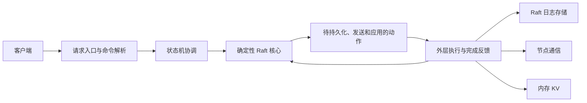

# RaftKV 项目导引

本页用于正式开工前建立总体认识。基础教学来自原 README（2026-10-13 调研，2026-10-19 路线更新），迁入此处保留推导与例子；实施规则以 [ROADMAP](../ROADMAP.md)、[workflow](workflow.md) 和 [testing](testing.md) 为准。

先读本页开头和第 2–4 节，了解 KV、复制和 Raft。不会后面的概念不影响从内存 KV 开始；AI 会在当前任务中提供设计、图示、必要理论和详细伪代码，知识补到足以动手。

## 先看整个项目

最终目标是一个受限的三节点 KV，能够按声明的条件验证换主、重启与请求重试。先用内存容器建立接口，再在可控消息环境实现协议，之后接磁盘与真实网络，最后检查端到端行为。当前只有文档，下面是计划设计，不表示模块已经存在。



v0.1 只实现终端输入、命令解析、KV 调用和结果输出；共识与恢复从后续版本引入。先看 AI 给出的当前版本设计图，再尝试核心代码；通过反馈逐渐学习解释和局部设计，不要求先独立画整套架构。

开工第一次交付是 v0.1 章节总览；第二次才生成 S01 note。每个小节按“讲解 → 本人尝试 → 只读审查与完整建议 → 本人批准 → 修改与验证 → 手动提交”完成。详细规范见 [工作流程](workflow.md)，测试随功能推进。

以下保留原始教学正文。第 8 节是学习关口的概念解释；实际版本顺序以 ROADMAP 为准。第 9 节的问题用于边做边讨论，不是开工前的考试或预习要求。

## 1. 先纠正我们的出发点

**分布式 KV 可以成为一个好项目，但“做它一定能进步一大截”缺少条件。**

如果你只是跟着教程填文件，最后展示三台服务器启动，收获可能主要是配置环境。如果你能解释一次请求、复现一个错误、证明修复有效，项目才开始成为你的能力。

学长推荐的是一个值得考察的方向；这不能替代你理解它。我此前根据你的网络编程经历判断可行，也应收回其中过强的确定性：目前还缺少你对持久化、状态机和故障处理的实际表现。

我的建议是：**把分布式 KV 作为可调整的主线，立即从最小的 KV 开始；先取得反馈，再扩大承诺。** 不恢复已经放弃的 110 天日程，也不要求你先学完一整套课程。

你愿意接受批评很好，但不需要把自己的判断权交给老师或 AI。遇到我说“这样更好”，你可以追问：解决什么问题？有什么反例？怎样验证？

## 2. KV 到底是什么

KV 是 **Key-Value，键值对**。可以把它想成一个按标签找东西的柜子：

| Key：标签 | Value：内容 |
| --- | --- |
| `user:42:nickname` | `Alice` |
| `service:search:max_workers` | `8` |
| `job:1001:status` | `running` |

同一个 Key 对应当前的一份 Value。最基本的操作只有三个：

```text
Put("user:42:nickname", "Alice")  -> 保存或覆盖
Get("user:42:nickname")           -> "Alice"
Delete("user:42:nickname")        -> 删除
Get("user:42:nickname")           -> NotFound
```

这里是接口示意，不是已经可以执行的程序。冒号只是我们给 Key 起名的习惯，不代表数据库自动理解“用户”“昵称”。Value 也可以是一段字节；第一版先用字符串。

**空字符串和不存在必须区分。** `Put("x", "")` 后，`Get("x")` 应该成功返回空字符串，不能返回 `NotFound`。

### 它和你熟悉的东西有什么关系

| 东西 | 提供什么 | 仍缺什么 |
| --- | --- | --- |
| C++ 的 `std::unordered_map` | 进程里按 Key 查 Value | 进程结束后恢复、远程访问、机器故障处理 |
| 单机持久化 KV | 数据写入本机存储，按约定恢复 | 机器不可用时，服务可能也不可用 |
| 网络 KV 服务 | 别的程序通过网络访问 KV | 只有一台服务时仍存在单点故障 |
| 多副本分布式 KV | 多个节点共同维护数据和操作顺序 | 需要处理断网、换主、恢复等复杂问题 |

网络编程经历能够帮助你理解连接、消息与请求，但数据正确性的责任是新课题。`netdict` 保持为已完成的学习项目，不要求改造它。

### 它用来做什么

可以保存服务配置、任务状态、系统元数据等“根据名字读写”的数据。真实系统还会按需求增加版本号、事务、订阅、过期等能力。

一个实际例子是 [etcd](https://github.com/etcd-io/etcd)：它是分布式 KV，用于保存分布式系统的重要数据，Kubernetes 是其使用场景之一。我们的目标远小于 etcd。

| 需求 | 基础 KV 是否合适 |
| --- | --- |
| 根据任务编号查询状态 | 很自然 |
| 根据名字读取一个配置项 | 很自然；订阅变化还需额外能力 |
| 查“过去一年各省消费前十的用户” | 只有三个基本接口不够，需要查询与索引等设计 |
| 保存大量视频文件 | 本项目不适合，通常另选对象或文件存储方案 |
| 做一个可靠分布式锁 | 不能仅靠 `Get` 后 `Put`，需要额外的原子操作和失效语义 |

KV 是数据组织与访问方式；Redis、etcd 等产品各有不同目标。做一个 KV，不等于复刻 Redis 的全部能力。

## 3. 为什么还要“分布式”

假设一个服务把配置存在节点 A。A 坏了，其他程序读不到配置。你很自然地想到：再放两份，存在 B 和 C。

但复制会带来新问题：

```text
开始：A、B、C 都保存 max_workers = 8

客户端请求：把它改为 16
A 收到了请求，B 收到了复制消息，C 暂时断网

此时 A 又退出了。
谁接替 A？16 到底算不算写成功？C 回来后该听谁的？
```

这些问题没有统一规则，就可能出现“有人读到 8，有人读到 16，两个节点都说自己是主节点”。

**分布式 KV 的核心难题，是让多个不总能及时通信的节点，仍能对已经确认的操作保持正确的共同历史。**

### 复制和分片是两个问题

| 做法 | 类比 | 主要目的 |
| --- | --- | --- |
| 复制：A、B、C 保存同一组数据 | 三份相同账本 | 容错 |
| 分片：A 管一部分 Key，B 管另一部分 | 分柜保管 | 分摊容量或负载 |

本项目首先做复制。三份完整副本不会自动把有效容量变为三倍；写入还要通信，可能比单机慢。以后同时做分片和复制，才会出现多组副本、数据迁移等问题，现在不引入。

同一台 Ubuntu 虚拟机里的三个进程，可以验证进程退出和模拟断网，但宿主机一停，三个都会停。它们不等于三个独立故障域中的生产节点。

## 4. Raft 是来解决哪部分问题的

Raft 是一种共识算法：在约定的故障模型下，让节点对一串操作的顺序达成一致。这里主要考虑进程崩溃、消息丢失或延迟，不考虑节点恶意伪造结果。[Raft 官方资料](https://raft.github.io/)

先记住以下五个词，不急着背完整算法：

| 词 | 通俗解释 |
| --- | --- |
| Leader | 当前负责组织复制的节点 |
| Follower | 接收复制、参与投票的节点 |
| Term | 一轮领导任期的编号，用于识别过时的领导者 |
| Log | 按顺序记录的操作，如“把 x 改成 16” |
| Commit / Apply | 确认操作可以生效 / 真正按顺序执行到 KV 状态中 |

这里的 Log 是复制协议的一部分，不是随手打印的调试日志。

### 一次写入的大致旅程

```text
客户端 Put("x", "16")
          |
          v
      Leader 接收
          |
          v
   将操作记入日志并复制 ─────> Follower B
          |              └─> Follower C
          v
   按协议和持久化约定满足提交条件
          |
          v
   按顺序 Apply：更新 KV，并取得结果
          |
          v
      回复客户端成功
```

三节点多数派是两个。多数派集合必有交集，但**“收到两个回复”本身不是完整的 Raft 正确性证明**：任期、投票资格、日志匹配、持久化时机等规则也必须成立。完整实现时再逐条研究。

| 情况 | 正确的理解 |
| --- | --- |
| 一个节点退出 | 剩余两个在能通信、能选主等条件下可以继续；切换期间可能短暂不可用 |
| 网络分成两个节点和一个节点 | 多数派一侧可以继续推进；孤立节点不能独自确认新写入 |
| 三个节点彼此都联系不上 | 不能为了“可用”就各自把写入当作已提交 |
| 三个节点稍后重新连通 | 需要按协议修复未提交的冲突部分，不能简单比较文件大小 |

这是在一致性目标下对故障作出的取舍，并不意味着系统在所有网络条件下都能持续服务。

### 两个比“选出 Leader”更容易漏掉的问题

**问题一：客户端超时，数据一定没写进去吗？**

不一定。操作可能已经提交，只是成功响应丢了。因此，超时应表达“结果未知”，不能直接解释为“没有发生”。可靠重试可能需要请求编号、去重记录，以及去重状态的恢复设计。即使 `Put` 相同值看似可重复，夹在其他写入之间的旧请求重试仍可能覆盖新值。[etcd API 语义](https://etcd.io/docs/v3.6/learning/api_guarantees/)

**问题二：读操作没有修改数据，随便找一个节点读就行吗？**

不一定。落后的副本或被隔离的旧 Leader 都可能返回旧值。如果我们的契约是“成功写入之后发起的读取必须看到该写入或更新的写入”，就必须设计读取协议。教学初版可以让读也经过共识顺序，代价是额外开销；不能先优化成随便本地读，再宣称强一致。[TinyKV Project 2](https://github.com/talent-plan/tinykv/blob/cf7ed8da34fea520c7e2f909e23bd5c27414961a/doc/project2-RaftKV.md)

## 5. “含金量”到底来自哪里

项目名不会自动增加竞争力。我的判断是：这个题材的价值在于，它能把多个基础知识变成同一个系统里不得不解决的问题。

| 你要解决的具体问题 | 为什么需要学 | 能留下什么证据 |
| --- | --- | --- |
| 一次连接没读到完整消息 | TCP 是字节流，需要消息边界与收发状态管理 | 拆包、合包测试 |
| 对象销毁时还有回调访问它 | 生命周期与并发控制关系到内存安全 | 最小复现、修复解释、检查结果 |
| 数据写了一半进程退出 | 写入、同步、文件格式与恢复有不同保证 | 故障位置、恢复结果、明确保证范围 |
| 旧 Leader 仍收到请求 | 任期与多数派规则限制错误写入 | 可重复的网络分区实验 |
| 某次测试偶尔失败 | 必须控制时间、消息和随机性才能定位 | 固定种子或可重放事件序列 |
| 三节点结果偶尔不一致 | 需要先定义什么叫正确，再检测历史 | 请求记录、模型对照、失败反例 |

这能为 C++ 系统、存储及后端方向提供可解释的项目材料；**不能据此保证实习，也不等于已经具备数据库内核经验或 AI 工程经验。** 转向其他领域时，测试、网络和故障分析能力较容易迁移，岗位知识仍要另补。

### 哪些东西看起来厉害，实际容易稀释学习

| 做法 | 问题 | 当前选择 |
| --- | --- | --- |
| 同时手写 Raft、RPC、协程、LSM、事务 | 一个故障可能涉及五个陌生模块，难以定位 | 每次只引入一个主要难点 |
| 先把大型仓库翻译成自己的 C++ | 容易复制结构，却解释不了取舍 | 先做最小模型，再按问题查源码 |
| 把三进程启动截图当作完成 | 没验证数据在故障下是否正确 | 用故障实验作为验收 |
| 先追求高吞吐数字 | 错误或放宽语义也可能让数字变好看 | 先确定语义与正确性，再测性能 |
| 把全部依赖都换成手写 | 学习范围失控 | 标明哪些自研、哪些复用及其边界 |

## 6. 这次考察后，怎样博采众长

详细版本、源码发现与限制见 [REFERENCES.md](../REFERENCES.md)。不要把下面的表当成必须全部读完的书单。

| 参考 | 借鉴什么 | 当前怎样用 |
| --- | --- | --- |
| MIT 6.5840 的 Raft / KV 实验 | 把选主、复制、恢复、KV 正确性拆开验证 | 遇到对应问题时读实验要求；不先找答案仓库 |
| TinyKV | 从单机进入 Raft，明确模块边界 | 先读 Project 1、2 的任务说明；后面的分片和事务暂缓 |
| NuRaft | C++ 如何接入已有 Raft，以及应用要提供什么 | 可用 calculator 示例观察复制；留意它默认不落盘 |
| etcd-io/raft | 协议核心与网络、磁盘的分离 | 写自己的小模型时参考输入、输出和测试边界 |
| etcd | 成熟系统如何描述保证、注入故障、检查操作历史 | 借测试思路，不复刻整个产品 |
| mini-lsm | 单机存储为什么本身就是一个大课题 | 先用于认清边界；以后喜欢存储再深入 |
| 中文 C++ Raft KV 教学项目 | 熟悉的语言和完整模块连接 | 当作可质疑的阅读材料；先核查恢复逻辑与测试证据 |

我的选择是：**用 TinyKV/MIT 帮我们组织问题，用 C++ 做自己的小实验，用 NuRaft/etcd 的实现与测试校正认识。** 不必为了读 Go 或 Rust 教材，立刻切换项目语言。

第一轮只需读本文。想看动态过程，可看 [Raft 官网](https://raft.github.io/)链接的[交互动画](https://thesecretlivesofdata.com/raft/)。动画建立直觉，不能覆盖持久化、读取和重试的完整正确性。

## 7. 第一个小版本：今天就可以从这里开做

**第一件事：写一个只有内存的 C++ KV，通过终端调用。** 它很小，但就是项目的第一块，不是项目开始前的额外课程。

先约定：Key、Value 用字符串；支持覆盖；找不到 Key 返回明确状态；删除不存在的 Key 返回 `NotFound`；这一版退出后丢数据。

| 实验 | 预期 |
| --- | --- |
| 保存 `x=8` 后读取 | 得到 `8` |
| 再保存 `x=16` 后读取 | 得到 `16` |
| 保存 `empty=""` 后读取 | 成功，值为空字符串 |
| 删除 `x` 后读取 | `NotFound` |
| 删除原本不存在的 Key | `NotFound`，程序正常运行 |
| 退出程序，再启动后读取旧 Key | `NotFound`；这是当前明确的能力边界 |

这一步会接触容器、接口返回值、少量测试和最小构建方式。不需要先写网络框架、线程池或一套“通用架构”。实现、构建、测试和项目 Git 操作在 Ubuntu 主副本进行；Windows 通过 Remote-SSH 编辑，不在 Windows 基线副本继续实现。

完成后，你应能回答：“目前数据在哪儿？谁调用谁？为什么重启会丢？”如果只能回答“用了某个库”，就先把这一层讲清。

接下来优先按 ROADMAP 建立可控实验环境；也可以按需观察一个现成的三节点示例：先预测谁负责写入，再关闭一个节点，记录请求与结果。NuRaft calculator 是候选，**它不是持久化 KV**；观察前应先核对固定版本的构建说明，不把退出后丢状态误认为你的操作错误。本次尚未下载或运行它。

## 8. 后续按问题推进，不先锁死大架构

| 关口 | 核心问题 | 通过的证据 |
| --- | --- | --- |
| A：内存 KV | 基本读写契约是什么？ | 上述小实验自动验证，能逐步解释执行 |
| B：理解复制 | 为什么不能三个节点各自写？ | 画出一次分区和换主过程，解释失败结果 |
| C：协议或集成 | 怎样让操作顺序可验证？ | 能控制消息、超时和故障，重现一个反例 |
| D：恢复 | 状态怎样跨进程退出保留下来？ | 按声明的故障模型恢复，区分已提交与未提交操作 |
| E：网络 KV | 真实请求、超时和重试怎样接入？ | 三进程读写、换主、重连与读取语义测试 |
| F：收尾 | 我们到底保证了什么？ | 可复现演示、故障记录、限制说明和有条件的性能数据 |

这些关口代表学习问题，不规定所有代码必须严格按表顺序写完。持久化规则要在 Raft 设计时考虑，不能把一个从不崩溃的模型直接当成可靠实现。

当前路线优先受限自研 Raft，在 v0.2 结束时复核成本；以下两种路线作为复核依据，改为接库时先更新计划与贡献说明：

| 路线 | 适合的兴趣 | 主要投入 | 边界 |
| --- | --- | --- | --- |
| 自己实现最小 Raft | 很想理解“协议为什么正确” | 先在单进程里模拟节点、时间和消息，再接真实网络与磁盘 | 调试成本高；初期不是完整服务 |
| 接入 NuRaft 等现成库 | 更想先完成可用服务、恢复与工程集成 | 实现应用状态机、存储接口、服务入口和故障测试 | 不能把库内部算法记成自己的实现 |

**当前优先实现小型 Raft 模型，再逐步接磁盘与网络。** 若你发现更喜欢服务与工程问题，走库集成路线也成立。只有经过第一轮实验，我们才有依据选择。

### 初始边界

- 三个固定成员，一个 Raft 组，一套 Key 空间；先处理崩溃与网络故障。
- 基础接口围绕 `Put / Get / Delete`；读写语义先写清楚。
- 暂不做分片、成员动态变更、跨 Key 事务、MVCC、自研完整 LSM、协程框架和云平台部署。
- 日志会增长；最初可以显式限制实验规模。快照与日志压缩在基础恢复可靠后再讨论，不能宣称已适合长期运行。
- “杀进程后可恢复”“机器掉电后可恢复”“磁盘损坏后可恢复”是不同保证，按实际实现和实验逐项声明。

若推进不顺，不要靠增加功能找成就感：先缩到可重放的协议模型，或缩到有恢复测试的单机 KV。它们都能形成完整作品，但简历名称必须如实对应。

## 9. 我们怎样一起学

每次只推进一个能验收的问题，采用以下循环：

```text
你先预测结果 → 做最小实验 → 找出预测与结果的差异
            → 解释原因 → 修复或调整设计 → 留下回归测试
```

我负责讲解、追问、找反例、查资料、审查和协助实现。对关键协议，我优先给分层提示，并在必要时给出完整解释；不把大量生成代码当作你已经掌握。

**下一次从这三个问题开始即可：**

1. 在第一版中，`unordered_map` 能完成什么，还不能完成什么？
2. A 已经写入、B 尚未收到、A 随后退出：为什么“发过复制消息”不等于“写成功”？
3. 客户端超时后，你还需要知道哪些信息，才能决定如何重试？

答不全很正常。答案暴露的缺口，就是下一次实验的内容。
